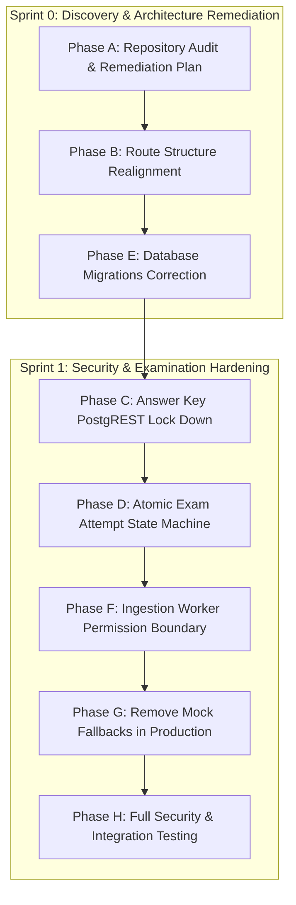

# StudPrep — V1 Stabilization Remediation Plan
## Architecture, Database, Security, and Examination Integrity

**Document Version**: 1.0.0  
**Date**: October 30, 2026  
**Status**: APPROVED FOR EXECUTION  
**Platform**: StudPrep AI-Powered CBT Examination System  
**Framework**: Next.js 16 (App Router / Turbopack), Supabase (PostgreSQL 15+ / PostgREST / GoTrue / Storage), TypeScript 5.8  

---

## 1. Executive Summary & Audit Context

An independent architectural and security audit of the StudPrep repository (`d:\StudPrep`) identified critical vulnerabilities, routing collisions, unauthorized data exposure, and brittle processing boundaries. This remediation plan outlines the identified defects, affected files, proposed architectural corrections, and verification criteria for **Stabilization Sprints 0 & 1**.

The platform is substantially implemented across Phases 1 through 11. Remediation focuses strictly on making the existing architecture structurally sound, secure, buildable, and production-ready without unnecessary rewrites or feature churn.

---

## 2. Identified Defect Catalog (Prioritized P0 – P2)

### P0 — Security & Integrity Critical

| Defect ID | Domain | Vulnerability / Defect Description | Affected Files | Proposed Remediation |
| :--- | :--- | :--- | :--- | :--- |
| **SEC-01** | **Answer Key Exposure** | Migration `20261029000003_questions.sql` creates policy `"questions: authenticated users can read public view"` directly on the base table `public.questions` with `USING (auth.role() = 'authenticated')`. Any authenticated student can issue `supabase.from('questions').select('correct_index, explanation')` to read all correct answers and explanations directly. | `supabase/migrations/20261029000003_questions.sql` `supabase/migrations/20261030000006_stabilization_remediation.sql` | Drop the leaky policy on base table `public.questions`. Restrict base table SELECT strictly to `admin` role. Ensure only `questions_public` view (which projects out answer keys) is accessible, or gate through server-side DTO queries. |
| **SEC-02** | **Exam Snapshot Answer Key Leak** | Migration `20261030000002_exam_studio_and_engine.sql` grants students SELECT on `public.exam_snapshots` where `auth.uid() = user_id`. Because `exam_snapshots.questions` contains full JSON with `correctOptionId`, worked explanations, and option rationales, candidates can query PostgREST during an active exam to read all answer keys. | `supabase/migrations/20261030000002_exam_studio_and_engine.sql` `app/actions/exam-engine.ts` `types/supabase.ts` | Drop direct student SELECT access to answer-key-bearing `exam_snapshots`. Allow read access only through trusted server actions using the service client, returning sanitized DTOs (`SanitizedQuestion[]`) during active exams and unlocking keys only post-finalization. |
| **SEC-03** | **Unrestricted Exam Attempt Writes** | Migration `20261030000002_exam_studio_and_engine.sql` grants students an unrestricted `FOR UPDATE` policy on `public.exam_attempts` where `auth.uid() = student_id`. A student can modify their own `score`, `marks_obtained`, `correct_count`, `status`, or extend `expires_at` directly from the browser console. | `supabase/migrations/20261030000002_exam_studio_and_engine.sql` `app/actions/exam-engine.ts` `supabase/migrations/20261030000006_stabilization_remediation.sql` | Revoke generic student UPDATE access to `exam_attempts`. Implement secure PostgreSQL RPC functions (`save_attempt_answer`, `clear_attempt_answer`, `toggle_attempt_review_flag`, `mark_question_visited`) or server-side service actions with row-level locks and strict server-authoritative validations. |
| **SEC-04** | **Invalid RLS Syntax (`OLD.role`)** | Migration `20261029000006_storage_and_role_protection.sql` line 36 attempts `WITH CHECK (auth.uid() = id AND role = OLD.role)`. PostgreSQL RLS policies cannot reference trigger `OLD` pseudo-records; this syntax triggers `ERROR: missing FROM-clause entry for table "old"` on clean Postgres instances. | `supabase/migrations/20261029000006_storage_and_role_protection.sql` `supabase/migrations/20261030000006_stabilization_remediation.sql` | Correct the policy to `WITH CHECK (auth.uid() = id)`. Rely on the existing `trg_prevent_self_role_elevation` `BEFORE UPDATE` trigger function, which legally inspects `OLD.role` and `NEW.role`. |
| **SEC-05** | **Document Processor Permission Boundary** | In `app/actions/documents.ts`, `processDocumentJob(supabase, ...)` passes the student's authenticated client into the ingestion processor. The processor attempts to insert pages into `document_pages` and update `document_processing_jobs`, which are restricted, causing processing failures unless given dangerous permissive RLS. | `app/actions/documents.ts` `lib/ingestion/processor.ts` | Use `createAdminClient()` strictly inside trusted server-side processing functions after verifying student ownership in the server action. |

### P1 — Architectural & Routing Defects

| Defect ID | Domain | Description | Affected Files | Proposed Remediation |
| :--- | :--- | :--- | :--- | :--- |
| **ROU-01** | **Root Route Collision** | `app/page.tsx` and `app/(dashboard)/page.tsx` both resolve to `/` because route groups `(dashboard)` do not contribute to URL pathnames. | `app/(dashboard)/page.tsx` `app/(dashboard)/dashboard/page.tsx` | Move dashboard pages into `app/(dashboard)/dashboard/` so that `/` resolves strictly to the public landing page, and `/dashboard` resolves to the student dashboard. |
| **ROU-02** | **Flattened Dashboard Sub-routes** | Analytics, materials, profile, and settings are located directly under `app/(dashboard)/analytics`, `app/(dashboard)/materials`, etc., resolving to `/analytics`, `/materials` instead of the required canonical `/dashboard/analytics`, `/dashboard/materials`. | `app/(dashboard)/*` `proxy.ts` `components/layout/sidebar.tsx` | Relocate sub-routes to `app/(dashboard)/dashboard/*`. Update all internal links, navigation menus, router pushes, server action revalidation paths, and edge proxy matchers. |
| **DAT-01** | **Missing Baseline Subjects & Hardcoded Non-Existent IDs** | No baseline subjects are seeded in migrations. In `app/actions/documents.ts` line 57, a fallback UUID `"00000000-0000-0000-0000-000000000001"` is hardcoded, causing foreign-key constraint violations on clean databases. | `app/actions/documents.ts` `supabase/migrations/20261030000006_stabilization_remediation.sql` | Seed official baseline examination subjects (JAMB General Mathematics, WAEC English Language, Physics, Chemistry, Biology) in a corrective migration. Validate subject existence in actions. |
| **UX-01** | **Mock Data Fallbacks in Production Routes** | Routes `/exam/[id]`, `/exam/[id]/results`, `/dashboard/materials`, and `/dashboard/materials/[id]` import and silently render `MOCK_EXAM_SESSION` and `MOCK_MATERIALS` when database operations fail. | `app/(exam)/exam/[id]/page.tsx` `app/(exam)/exam/[id]/results/page.tsx` `app/(dashboard)/materials/page.tsx` | Remove mock data fallbacks from production route handlers. Implement truthful UI states (404 Not Found, 403 Forbidden, 500 Processing Failure, Empty States). |
| **AI-01** | **Silent Mock AI Fallback in Production** | `lib/ai/provider.ts` silently falls back to `MockAIProvider` if `GEMINI_API_KEY` is missing, giving false positives in production environments. | `lib/ai/provider.ts` | Make `getAIProvider()` throw an explicit error in production environments if `GEMINI_API_KEY` is unconfigured. Allow mock provider only in test/demo environments. |

---

## 3. Step-by-Step Remediation Workstreams

---

## 4. Detailed Implementation Strategy

### Phase B: Next.js Routing Realignment
1. Move `app/(dashboard)/page.tsx` -> `app/(dashboard)/dashboard/page.tsx`.
2. Move `app/(dashboard)/materials/` -> `app/(dashboard)/dashboard/materials/`.
3. Move `app/(dashboard)/exams/builder/` -> `app/(dashboard)/dashboard/exams/builder/`.
4. Move `app/(dashboard)/analytics/` -> `app/(dashboard)/dashboard/analytics/`.
5. Move `app/(dashboard)/profile/` -> `app/(dashboard)/dashboard/profile/`.
6. Move `app/(dashboard)/settings/` -> `app/(dashboard)/dashboard/settings/`.
7. Move `app/(dashboard)/subjects/` -> `app/(dashboard)/dashboard/subjects/`.
8. Audit and update all navigation links in components, `proxy.ts`, E2E tests, and `revalidatePath` calls.

### Phase C & D: Supabase Security & RPC Hardening
1. Create `supabase/migrations/20261030000006_stabilization_remediation.sql`.
2. Revoke public/student SELECT on base `questions` table; drop policy `"questions: authenticated users can read public view"`.
3. Revoke direct student SELECT on `exam_snapshots.questions` containing answer keys.
4. Revoke student UPDATE on `exam_attempts`.
5. Create PostgreSQL functions with `SECURITY DEFINER` and `SET search_path = public`:
   - `save_attempt_answer(p_attempt_id, p_question_id, p_option_id)`
   - `clear_attempt_answer(p_attempt_id, p_question_id)`
   - `toggle_attempt_review_flag(p_attempt_id, p_question_id, p_flag)`
   - `mark_attempt_question_visited(p_attempt_id, p_question_id)`
   - `finalize_exam_attempt(p_attempt_id)`
6. Each function verifies:
   - `auth.uid() = student_id`
   - `status = 'in_progress'`
   - `now() <= expires_at`
   - Atomic update of JSONB fields (`answers = jsonb_set(...)`).

### Phase E: Migration Syntax & Baseline Seeding
1. Fix `profiles: users can update own non-role` policy without `OLD.role` reference.
2. Seed baseline examination subjects: General Mathematics, English Language, Physics, Chemistry, Biology.
3. Remove fallback dummy UUID in `app/actions/documents.ts`.

### Phase F: Ingestion Worker Boundary
1. Refactor `lib/ingestion/processor.ts` to execute privileged database mutations using `createAdminClient()`.
2. Ensure caller authorization check remains in `app/actions/documents.ts`.

### Phase G: Truthful Error Handling
1. Replace `MOCK_EXAM_SESSION` fallback in `app/(exam)/exam/[id]/page.tsx` with `notFound()` or error screen.
2. Replace mock fallbacks in results and materials pages.
3. Configure `getAIProvider()` to throw if `GEMINI_API_KEY` is missing in production.

---

## 5. Verification & Acceptance Criteria

1. **Routing Verification**:
   - `curl http://localhost:3000/` returns public landing page only.
   - `curl http://localhost:3000/dashboard` redirects unauthenticated user to `/login?redirectTo=/dashboard`.
   - All sub-routes resolve to `/dashboard/*`.
2. **Security Negative Tests**:
   - Student A querying `supabase.from('questions').select('correct_index')` receives 0 rows or 403 Forbidden.
   - Student A querying `supabase.from('exam_snapshots').select('questions')` receives 0 rows or sanitized content.
   - Student A attempting `supabase.from('exam_attempts').update({ score: 100 })` is rejected by PostgreSQL RLS.
   - Student A attempting to alter `role = 'admin'` is rejected by `trg_prevent_self_role_elevation`.
3. **Build & Test Suite**:
   - `pnpm type-check` exits 0.
   - `pnpm lint` exits 0.
   - `pnpm test` passes all unit and integration tests.
   - `pnpm build` completes with 0 errors.

